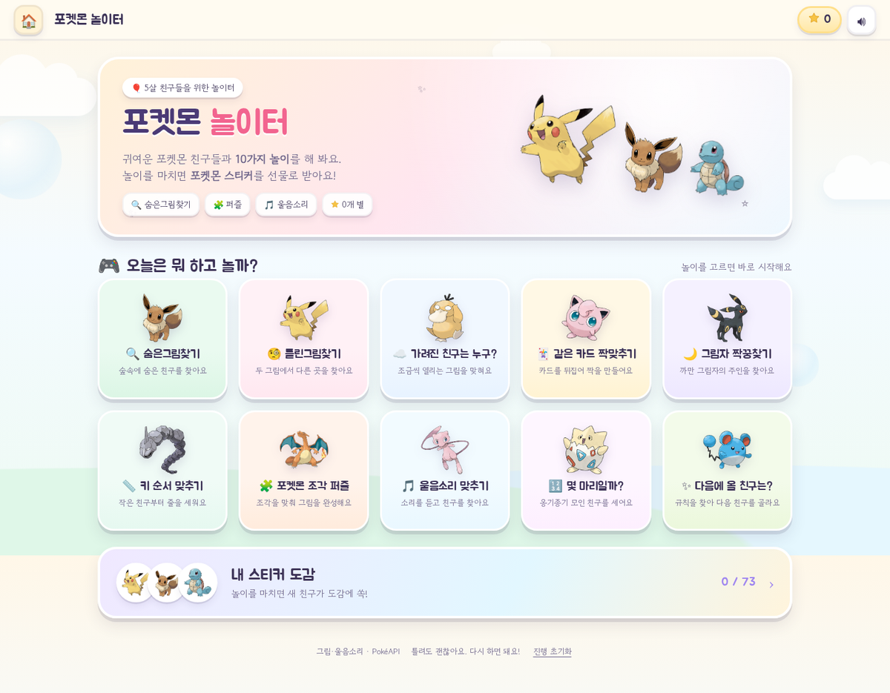
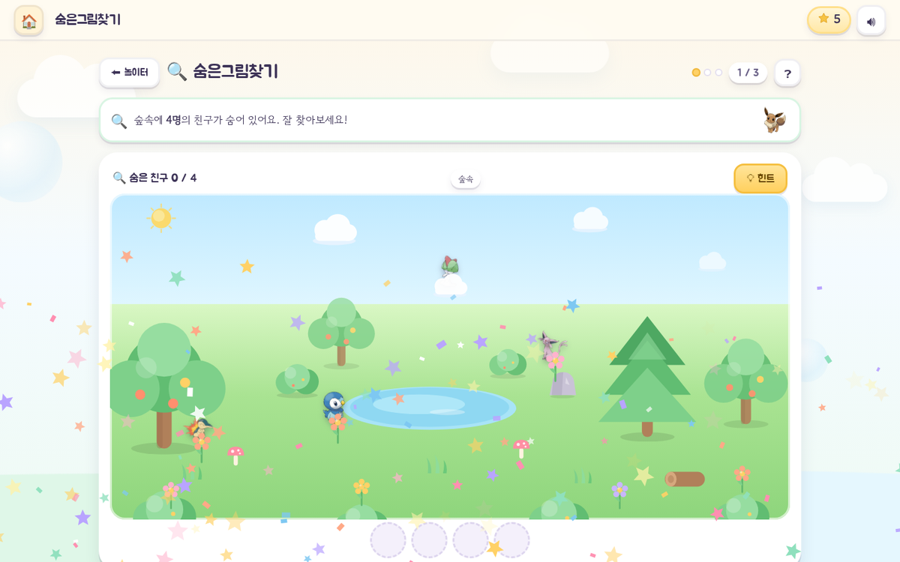
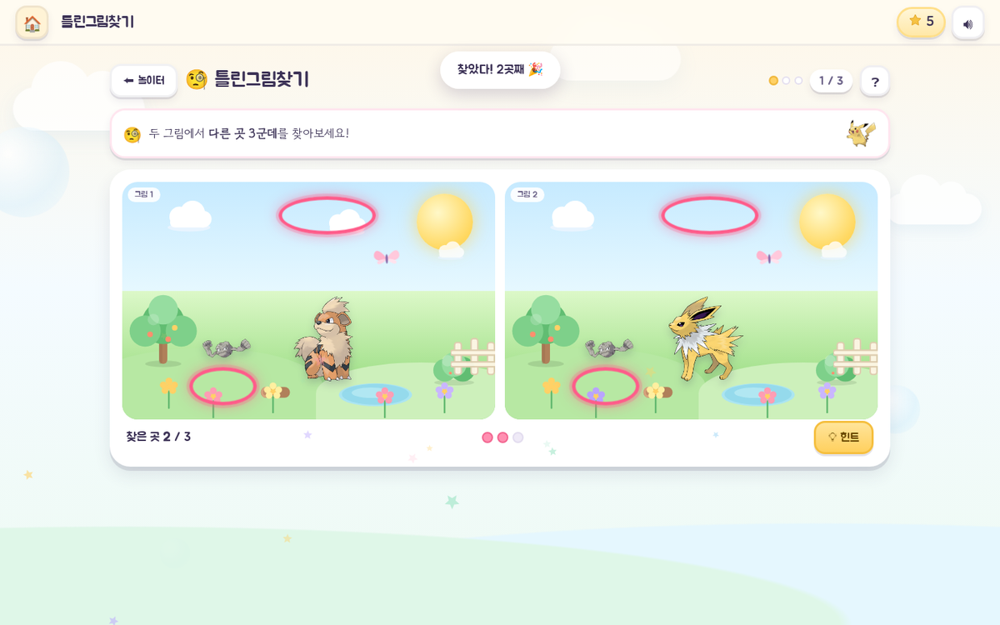

# 🎈 포켓몬 놀이터 — 유치원 미니게임 10종

5살 친구들이 **태블릿 · 스마트폰 · PC**에서 바로 즐길 수 있는 포켓몬 미니게임 모음입니다.
틀려도 벌이 없고, 놀이를 마치면 **포켓몬 스티커**가 도감에 쏙 들어와요.

### 👉 바로 놀러 가기

**https://bbangdenge-314.github.io/pokemon-minigames/**



| 숨은그림찾기 | 틀린그림찾기 |
| --- | --- |
|  |  |

| 클리어 보상 | 스티커 도감 |
| --- | --- |
|  |  |

---

## 🎮 놀이 10종

| # | 놀이 | 어떻게 놀아요? | 구성 |
| --- | --- | --- | --- |
| 1 | 🔍 **숨은그림찾기** | 숲속·바닷속·꽃밭에 숨어 있는 포켓몬을 찾아 콕! 나뭇잎·구름·산호 뒤에 살짝 숨어 있어요. | 3판 (4·5·5마리) |
| 2 | 🧐 **틀린그림찾기** | 나란히 놓인 두 그림에서 다른 곳을 찾아요. 포켓몬·구름·꽃·나비·해가 달라져요. | 3판 (3·4·5곳) |
| 3 | ☁️ **가려진 친구는 누구?** | 구름 조각을 하나씩 열거나 손전등으로 비춰 보며 어떤 포켓몬인지 맞혀요. | 3판 |
| 4 | 🃏 **같은 카드 짝맞추기** | 카드를 뒤집어 같은 포켓몬 짝을 찾아요. 6장 / 12장 / 16장 중에 골라요. | 2판 |
| 5 | 🌙 **그림자 짝꿍찾기** | 까만 실루엣을 보고 똑같은 포켓몬을 찾아 짝지어 줘요. | 3판 (3쌍씩) |
| 6 | 📏 **키 순서 맞추기** | 도감 키(cm)를 보고 작은 친구부터 큰 친구 순서로 줄을 세워요. 그림 크기도 힌트! | 3판 (3·3·4마리) |
| 7 | 🧩 **포켓몬 조각 퍼즐** | 조각 두 개를 차례로 눌러 자리를 바꾸며 그림을 완성해요. 2×2 / 3×3 선택. | 2판 |
| 8 | 🎵 **울음소리 맞추기** | 실제 포켓몬 울음소리를 듣고 누구인지 맞혀요. 몇 번이든 다시 들을 수 있어요. | 3판 |
| 9 | 🔢 **몇 마리일까?** | 옹기종기 모인 포켓몬을 손가락으로 짚으며 세고 숫자를 눌러요. (1~10마리) | 3판 |
| 10 | ✨ **다음에 올 친구는?** | A-B-A-B, A-A-B, A-B-C 규칙을 찾아 물음표 자리에 올 친구를 골라요. | 3판 |

---

## 💛 아이를 위한 약속

- **게임오버가 없어요.** 틀리면 "괜찮아, 다시 해볼까?" 하고 부드럽게 격려하고, 감점도 벌도 없어요.
- **정답은 신나게.** 별가루 파티클, 색종이, 박수·딩동댕 효과음, 그리고 그 포켓몬의 **진짜 울음소리**가 함께 나와요.
- **큰 손가락을 위해.** 주요 버튼은 56~64px 이상, 게임 카드는 180px 크기로 만들어요.
- **힌트는 언제나 공짜.** 막히면 💡 힌트 버튼을 눌러요. 틀린 횟수도 세지 않아요.
- **글을 몰라도 OK.** 모든 안내는 짧은 한국어 + 그림 + 이모지로 되어 있어요.
- **소리 끄기.** 오른쪽 위 🔊 버튼으로 언제든 조용히 놀 수 있어요.

## ⭐ 보상: 별과 스티커 도감

- 놀이를 끝내면 **별 5개**와 **새 포켓몬 스티커 1장**을 받아요.
- 스티커는 **내 스티커 도감**(전체 73마리)에 차곡차곡 쌓여요. 도감에서 스티커를 누르면 울음소리를 들려줘요.
- 별과 스티커는 브라우저(`localStorage`)에 저장되어, 앱을 껐다 켜도 그대로 남아 있어요.
- 도감 아래 **진행 초기화**를 누르면 별·스티커·놀이 기록이 모두 지워져요. (확인 창에서 한 번 더 물어봐요)

## 🕹️ 조작법

- **태블릿 · 스마트폰**: 손가락으로 콕콕 누르기. 가로·세로 모두 괜찮아요.
- **PC**: 마우스로 클릭. 키보드 `Esc`로 열린 창을 닫을 수 있어요.
- 화면 위 **⬅ 놀이터** 버튼으로 언제든 놀이 목록으로 돌아가요.

> 💡 태블릿에서는 브라우저 주소창을 숨기고 **홈 화면에 추가**하면 앱처럼 전체 화면으로 즐길 수 있어요.

## 🔧 만든 방식

- **정적 웹앱**: HTML + CSS + 바닐라 JavaScript(ES Modules). 빌드 과정 없이 GitHub Pages에서 바로 동작해요.
- **그림**: [PokéAPI](https://pokeapi.co) 공식 아트워크 (`raw.githubusercontent.com/PokeAPI/sprites`)
- **이름·타입·키**: PokéAPI 한국어 데이터 (전국도감 73마리)
- **울음소리**: PokéAPI cries를 `media/cries/{도감번호}.mp3`로 저장해 빠르고 안정적으로 재생 (원본이 없으면 PokéAPI 원격 주소로 자동 대체)
- **효과음**: Web Audio API로 직접 합성 (딩동댕, 박수, 별가루, 톡톡)
- **장면 그림**: 바닷속·숲속·꽃밭·우주 배경과 나무·산호·행성 등을 SVG로 직접 그려 조합
- **기억**: `localStorage` (`pokemon-playground-v1`)

### 파일 구조

```
pokemon-minigames/
├─ index.html              # 화면 뼈대 (상단바 · 화면 · 이펙트 캔버스)
├─ css/
│  ├─ style.css            # 디자인 시스템, 로비, 스티커 도감, 모달
│  └─ games.css            # 미니게임 10종 레이아웃
├─ js/
│  ├─ app.js               # 라우팅(#/ · #/book · #/play/:id), 로비, 도감, 보상
│  ├─ core.js              # 저장소, 소리, 파티클, 모달, 공용 UI
│  ├─ data.js              # 포켓몬 73마리 · 놀이 10종 메타데이터
│  └─ games/
│     ├─ hidden.js  diff.js  cover.js  memory.js  shadow.js
│     ├─ height.js  puzzle.js  cry.js  count.js  pattern.js
│     └─ scene.js          # 숲·바다·꽃밭·우주 장면 SVG 빌더
└─ media/
   ├─ cries/               # 포켓몬 울음소리 73개 (mp3)
   └─ screenshots/         # README 스크린샷
```

### 로컬에서 실행

```bash
cd pokemon-minigames
python3 -m http.server 8000
# 브라우저에서 http://localhost:8000
```

> ES Modules를 쓰기 때문에 `index.html`을 파일로 직접 열면 안 되고, 꼭 간단한 서버로 열어 주세요.

## ✅ 검증

Playwright로 실제 브라우저에서 전 놀이를 플레이해 확인했어요.

- **PC 1440×900**: 로비 → 10종 미니게임 전부 진입 → 각 판 정답 처리 → 클리어 모달 → 스티커 지급 → 도감 저장 → '한 번 더' 재시작 → 진행 초기화까지 통과
- **모바일 390×844 (`hasTouch: true`)**: 터치로 숨은그림찾기·틀린그림찾기·메모리·숫자세기·퍼즐 완주, 가로 스크롤 없음(overflow 0px)
- **콘솔/페이지 에러 0건**, 이미지 로드 실패 시에도 포켓볼 대체 이미지로 놀이가 멈추지 않음


## 📝 업데이트

`main` 브랜치에 커밋하면 GitHub Pages가 자동으로 다시 배포해요(보통 1~2분).
CSS/JS를 고친 뒤 캐시가 걱정되면 `index.html`의 `css/style.css?v=2`처럼 버전을 올려 주세요.

## 🙏 크레딧

- 포켓몬 이미지·울음소리·도감 데이터: [PokéAPI](https://pokeapi.co)
- 포켓몬과 포켓몬 캐릭터는 Nintendo / Creatures Inc. / GAME FREAK inc.의 상표입니다. 이 앱은 아이와 함께 놀기 위한 **비영리 팬 프로젝트**이며, 원 저작권자와 공식적인 관련이 없습니다.
