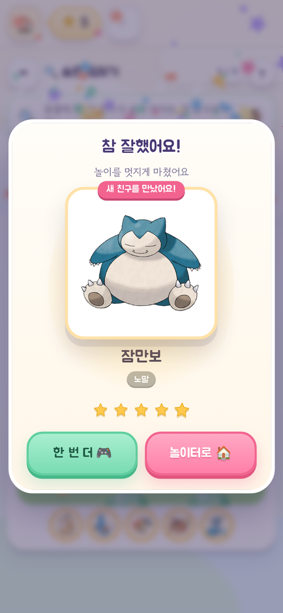
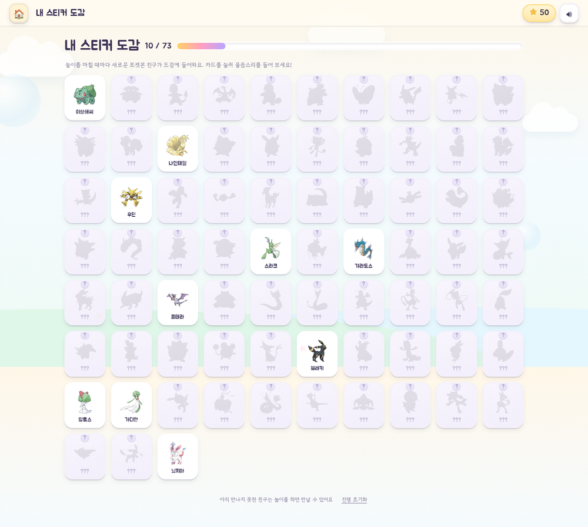

# 🎈 포켓몬 놀이터 — 유치원 미니게임 10종

5살 친구들이 **태블릿 · 스마트폰 · PC**에서 바로 즐길 수 있는 포켓몬 미니게임 모음입니다.
놀이마다 **쉬움(⭐) · 보통(⭐⭐) · 어려움(⭐⭐⭐)** 난이도를 골라서 즐길 수 있고,
숨은그림찾기·틀린그림찾기는 **32가지 배경 도안**으로 매번 새로운 그림이 나와요.
틀려도 벌이 없고, 놀이를 마치면 **포켓몬 스티커**가 도감에 쏙 들어와요.

### 👉 바로 놀러 가기

**https://bbangdenge-314.github.io/pokemon-minigames/**


| 숨은그림찾기 | 틀린그림찾기 |
| --- | --- |
|  |  |

| 클리어 보상 | 스티커 도감 |
| --- | --- |
|  |  |

---

## ⭐ 난이도 3단계

- **로비 위쪽**과 **놀이 화면 위쪽** 어디서든 ⭐ / ⭐⭐ / ⭐⭐⭐ 를 눌러 바꿀 수 있어요.
- 고른 난이도는 브라우저에 저장되어, 앱을 껐다 켜도 그대로예요.
- 놀이 중에 난이도를 바꾸면 그 판을 새 난이도로 다시 시작해요.

| 놀이 | 쉬움 ⭐ | 보통 ⭐⭐ | 어려움 ⭐⭐⭐ |
| --- | --- | --- | --- |
| 🔍 **숨은그림찾기** | 3마리 · 크게 | 5마리 · 중간 · 소품에 가림 | 7마리 · 작고 교묘한 위치 · 방해 친구 5마리 |
| 🧐 **틀린그림찾기** | 3곳 · 뚜렷한 차이 | 5곳 | 7곳 · 색·방향·크기 등 세밀한 차이 |
| ☁️ **가려진 친구는 누구?** | 3×3 구름 · 빨리 열림 | 4×4 구름 | 5×5 구름 · 6지선다 |
| 🃏 **같은 카드 짝맞추기** | 6장 (3쌍) | 12장 (6쌍) | 20장 (10쌍) |
| 🌙 **그림자 짝꿍찾기** | 3쌍 | 4쌍 | 6쌍 · 닮은꼴 친구 |
| 📏 **키 순서 맞추기** | 3마리 · 키(cm)와 그림 크기 힌트 | 4마리 · 키(cm) 힌트 | 5마리 · 숫자 없이 그림으로만 |
| 🧩 **포켓몬 조각 퍼즐** | 2×2 | 3×3 | 4×4 |
| 🎵 **울음소리 맞추기** | 3지선다 | 4지선다 | 6지선다 |
| 🔢 **몇 마리일까?** | 1~5마리 | 4~10마리 | 8~18마리 · 움직여요 |
| ✨ **다음에 올 친구는?** | A-B-A-B | A-A-B · A-B-B · A-B-C | A-A-B-B · A-B-C-D · A-B-A-C |

## 🎨 숨은그림찾기 · 틀린그림찾기 도안 32가지

배경·지형·소품이 완전히 다른 32가지 장면이 준비되어 있어요.
판이 바뀔 때마다 **같은 도안이 연달아 나오지 않게** 섞이고,
**🎨 도안** 버튼으로 직접 다른 그림을 골라서 놀 수도 있어요.

| | | | |
| --- | --- | --- | --- |
| 🌳 초록 숲속 | 🐠 산호 바닷속 | 🌸 봄 꽃밭 | 🌌 밤하늘 우주 |
| 🏔️ 눈 덮인 설산 | 🏜️ 사막 오아시스 | 🌋 뜨거운 화산 | 🏰 으스스 유령성 |
| 🏥 포켓몬 센터 | 🛝 신나는 놀이터 | ⛺ 별빛 캠핑장 | 💦 시원한 폭포 |
| 🎋 대나무 숲 | 🌸 벚꽃 공원 | 🌈 무지개 언덕 | 🏛️ 고대 신전 유적 |
| ☁️ 구름 위 하늘섬 | 💎 보석 동굴 | 🐑 푸른 목장 | 🎡 관람차 놀이공원 |
| 📚 아늑한 도서관 | 🧁 달콤 베이커리 | 🚂 기차역 플랫폼 | 🏴‍☠️ 바다 위 해적선 |
| 🧊 북극 빙하 | 🌴 열대 정글 | 🍁 가을 단풍길 | 🐟 대형 수족관 |
| 🌿 비밀 온실 정원 | 🗼 등대 바닷가 | 🌃 도시 야경 공원 | 🏯 단풍 사찰 마을 |

각 도안은 하늘·바닥 그라데이션부터 나무·건물·다리·열기구·수족관·케이크·기차·텐트·화산·유적 같은
고유 소품까지 SVG로 직접 그려 조합했어요.

---

## 🎮 놀이 10종

| # | 놀이 | 어떻게 놀아요? | 구성 |
| --- | --- | --- | --- |
| 1 | 🔍 **숨은그림찾기** | 32가지 장면 어딘가에 숨어 있는 포켓몬을 찾아 콕! 나뭇잎·구름·산호·소품 뒤에 살짝 숨어 있어요. | 3판 |
| 2 | 🧐 **틀린그림찾기** | 나란히 놓인 두 그림에서 다른 곳을 찾아요. 포켓몬·구름·꽃·나무·소품이 달라져요. | 3판 |
| 3 | ☁️ **가려진 친구는 누구?** | 구름 조각을 하나씩 열어 보며 어떤 포켓몬인지 맞혀요. | 3판 |
| 4 | 🃏 **같은 카드 짝맞추기** | 카드를 뒤집어 같은 포켓몬 짝을 찾아요. | 난이도별 1~3판 |
| 5 | 🌙 **그림자 짝꿍찾기** | 까만 실루엣을 보고 똑같은 포켓몬을 찾아 짝지어 줘요. | 3판 |
| 6 | 📏 **키 순서 맞추기** | 도감 키를 보고 작은 친구부터 큰 친구 순서로 줄을 세워요. | 3판 |
| 7 | 🧩 **포켓몬 조각 퍼즐** | 조각 두 개를 차례로 눌러 자리를 바꾸며 그림을 완성해요. | 2판 |
| 8 | 🎵 **울음소리 맞추기** | 실제 포켓몬 울음소리를 듣고 누구인지 맞혀요. 몇 번이든 다시 들을 수 있어요. | 3판 |
| 9 | 🔢 **몇 마리일까?** | 옹기종기 모인 포켓몬을 손가락으로 짚으며 세고 숫자를 눌러요. | 3판 |
| 10 | ✨ **다음에 올 친구는?** | 규칙을 찾아 물음표 자리에 올 친구를 골라요. | 3판 |

---

## 💛 아이를 위한 약속

- **게임오버가 없어요.** 틀리면 "괜찮아, 다시 해볼까?" 하고 부드럽게 격려하고, 감점도 벌도 없어요.
- **정답은 신나게.** 별가루 파티클, 색종이, 박수·딩동댕 효과음, 그리고 그 포켓몬의 **진짜 울음소리**가 함께 나와요.
- **큰 손가락을 위해.** 주요 버튼은 48~64px 이상, 놀이 카드는 186px 크기로 만들어요.
- **힌트는 언제나 공짜.** 막히면 💡 힌트 버튼을 눌러요. 틀린 횟수도 세지 않아요.
- **글을 몰라도 OK.** 모든 안내는 짧은 한국어 + 그림 + 이모지로 되어 있어요.
- **소리 끄기.** 오른쪽 위 🔊 버튼으로 언제든 조용히 놀 수 있어요.

## ⭐ 보상: 별과 스티커 도감

- 놀이를 끝내면 **별 5개**와 **새 포켓몬 스티커 1장**을 받아요.
- 스티커는 **내 스티커 도감**(전체 73마리)에 차곡차곡 쌓여요. 도감에서 스티커를 누르면 울음소리를 들려줘요.
- 별·스티커·난이도는 브라우저(`localStorage`)에 저장되어, 앱을 껐다 켜도 그대로 남아 있어요.
- 도감 아래 **진행 초기화**를 누르면 별·스티커·놀이 기록이 모두 지워져요. (확인 창에서 한 번 더 물어봐요)

## 🕹️ 조작법

- **태블릿 · 스마트폰**: 손가락으로 콕콕 누르기. 가로·세로 모두 괜찮아요.
- **PC**: 마우스로 클릭. 키보드 `Esc`로 열린 창을 닫을 수 있어요.
- 화면 위 **⬅ 놀이터** 버튼으로 언제든 놀이 목록으로 돌아가요.

> 💡 태블릿에서는 브라우저 주소창을 숨기고 **홈 화면에 추가**하면 앱처럼 전체 화면으로 즐길 수 있어요.

## 🔧 만든 방식

- **정적 웹앱**: HTML + CSS + 바닐라 JavaScript(ES Modules). 빌드 과정 없이 GitHub Pages에서 바로 동작해요.
- **그림**: [PokéAPI](https://pokeapi.co) 공식 아트워크 (`raw.githubusercontent.com/PokeAPI/sprites`)
- **이름·타입·키**: PokéAPI 한국어 데이터 (전국도감 73마리)
- **울음소리**: PokéAPI cries를 `media/cries/{도감번호}.mp3`로 저장해 빠르고 안정적으로 재생 (원본이 없으면 PokéAPI 원격 주소로 자동 대체)
- **효과음**: Web Audio API로 직접 합성 (딩동댕, 박수, 별가루, 톡톡)
- **장면 그림**: 32가지 도안의 하늘·지형 그라데이션과 70여 가지 SVG 소품(나무·산호·건물·놀이기구·기차·해적선·보석 등)을 조합
- **기억**: `localStorage` (`pokemon-playground-v1`)

### 파일 구조

```
pokemon-minigames/
├─ index.html              # 화면 뼈대 (상단바 · 화면 · 이펙트 캔버스)
├─ css/
│  ├─ style.css            # 디자인 시스템, 로비, 스티커 도감, 모달
│  └─ games.css            # 미니게임 10종 레이아웃 · 난이도 스위치
├─ js/
│  ├─ app.js               # 라우팅(#/ · #/book · #/play/:id), 로비, 도감, 난이도, 보상
│  ├─ core.js              # 저장소, 소리, 파티클, 모달, 공용 UI
│  ├─ data.js              # 포켓몬 73마리 · 놀이 10종 · 난이도 3단계
│  └─ games/
│     ├─ hidden.js  diff.js  cover.js  memory.js  shadow.js
│     ├─ height.js  puzzle.js  cry.js  count.js  pattern.js
│     └─ scene.js          # 32가지 도안 · SVG 소품 빌더
└─ media/
   ├─ cries/               # 포켓몬 울음소리 73개 (mp3)
   └─ screenshots/         # README 스크린샷
```

### 로컬에서 실행

```bash
cd pokemon-minigames
python3 -m http.server 8000
# 브라우저에서 http://localhost:8000
```

> ES Modules를 쓰기 때문에 `index.html`을 파일로 직접 열면 안 되고, 꼭 간단한 서버로 열어 주세요.

## ✅ 검증

Playwright로 실제 브라우저에서 전 놀이를 플레이해 확인했어요.

- **PC 1440×900 · 쉬움/보통/어려움 각각**: 로비 → 10종 미니게임 전부 진입 → 각 판 정답 처리 → 클리어 모달 → 스티커 지급 → 도감 저장까지 **30회 완주, 콘솔·페이지 에러 0건**
- **난이도 전환**: 로비와 놀이 화면 양쪽에서 3단계 전환·저장(localStorage) 확인
- **도안 32종**: 숨은그림찾기·틀린그림찾기 모두 32개 도안을 하나씩 불러 렌더(배경 32종 모두 다름, 깨진 이미지 0), 틀린그림찾기는 차이 지점의 픽셀 차이까지 확인
- **모바일 390×844 (`hasTouch: true`)**: 터치로 숨은그림찾기 완주, 5×5 구름(25칸)·6지선다·20장 카드·20칸 숫자판까지 렌더, 가로 스크롤 없음(overflow 0px)
- **콘솔/페이지 에러 0건**, 이미지 로드 실패 시에도 포켓볼 대체 이미지로 놀이가 멈추지 않음

## 📝 업데이트

`main` 브랜치에 커밋하면 GitHub Pages가 자동으로 다시 배포해요(보통 1~2분).
CSS/JS를 고친 뒤 캐시가 걱정되면 `index.html`의 `css/style.css?v=2`처럼 버전을 올려 주세요.

## 🙏 크레딧

- 포켓몬 이미지·울음소리·도감 데이터: [PokéAPI](https://pokeapi.co)
- 포켓몬과 포켓몬 캐릭터는 Nintendo / Creatures Inc. / GAME FREAK inc.의 상표입니다. 이 앱은 아이와 함께 놀기 위한 **비영리 팬 프로젝트**이며, 원 저작권자와 공식적인 관련이 없습니다.
